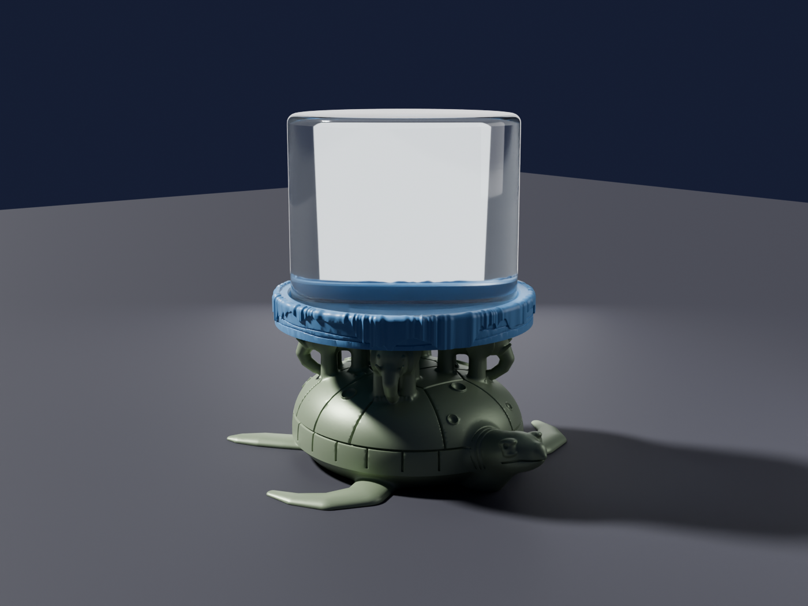
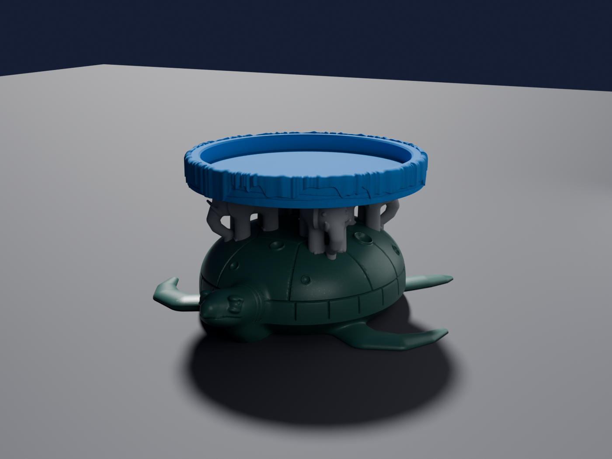
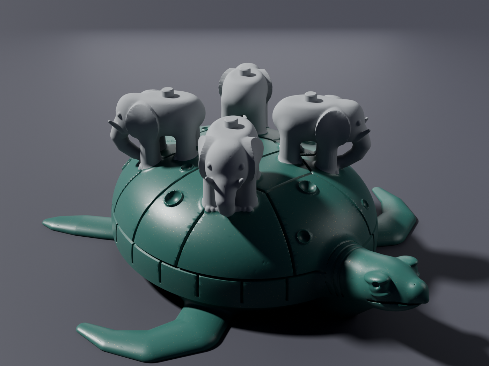
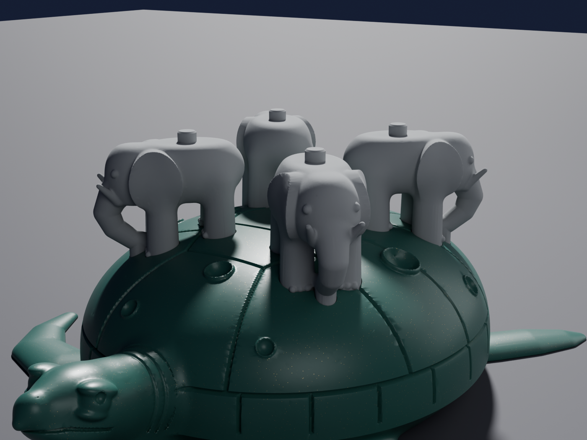
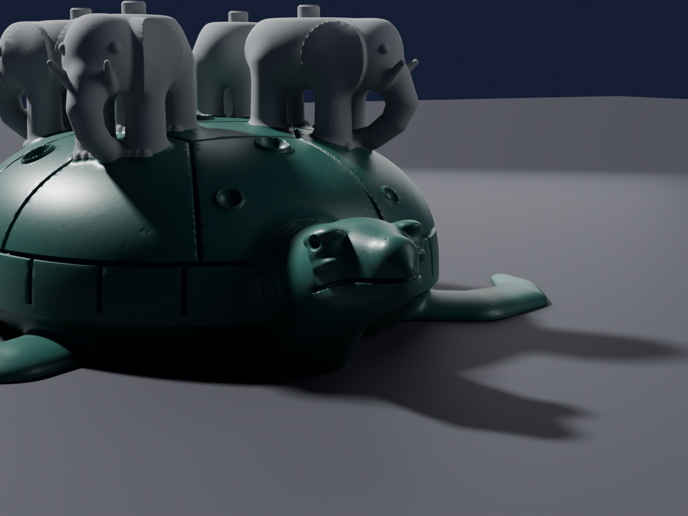
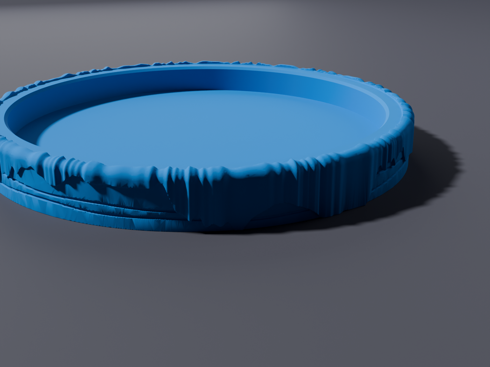
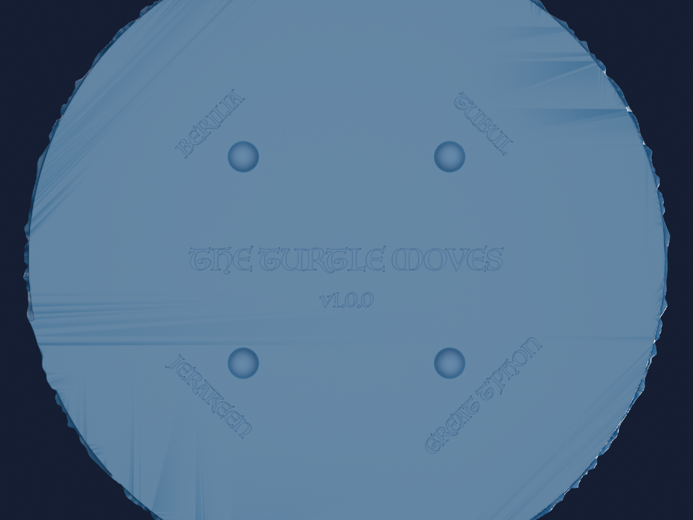
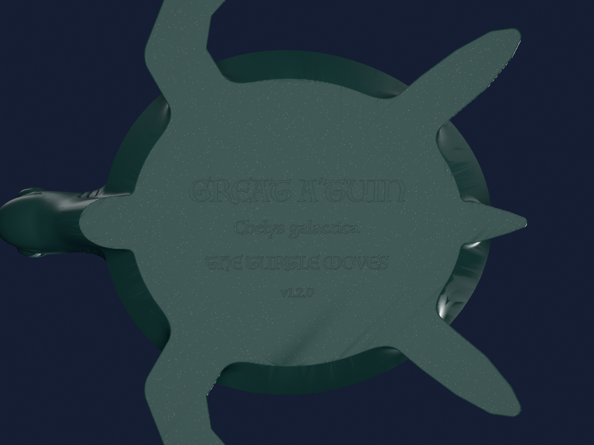

# Great A'Tuin Jar Stand

A 3D-printable stand for a round, flat-bottomed jar, in the shape of Discworld's Great A'Tuin.
The star turtle swims along with the four World Elephants on her shell. The elephants carry the
Disc, and the jar sits down in the Disc.



> "Great A'Tuin the turtle comes, swimming slowly through the interstellar gulf …
> his huge and ancient shell pocked with meteor craters." (Terry Pratchett, *The Colour of Magic*)

It prints as two pieces. The base can be printed in two colours, with grey elephants on a
green turtle.

| Piece | Files | Size |
|---|---|---|
| **Base**: A'Tuin carrying Berilia, Tubul, Great T'Phon and Jerakeen | `great_atuin_base.stl` (one colour), or `great_atuin_base_turtle.stl` + `great_atuin_base_elephants.stl` (two colours) | 239 × 238 × 98 mm |
| **Disc**: a cradle the jar sits in, with the Rimfall pouring off its edge | `great_atuin_disc_152.4mm.stl` | 177 mm across, 22 mm tall |
| **Both, ready to print**: a Bambu Studio project with every part on its filament | `great_atuin_152.4mm.3mf` | plate 1: base, plate 2: Disc |

Pegs on the elephants' backs key into holes under the Disc. Only the Disc depends on the jar's
size, so if your jar is different you regenerate and reprint just the Disc (see
[Fit your jar](#fit-your-jar)).

## Gallery

These are Blender renders of the STLs, in the filament colours below. Photos of real prints go
in [`photos/`](#photos).

| | |
|---|---|
|  |  |
| The Disc resting on the elephants | The base: scutes, meteor craters, flippers flat on the bed |
|  |  |
| The World Elephants in grey, trunks curled to their feet | "Sea-sized eyes crusted with rheum" |
|  |  |
| The Rimfall pouring over rock strata | Under the Disc: each elephant's name by its peg hole |



The underside of the base is engraved with *GREAT A'TUIN · Chelys galactica · THE TURTLE MOVES*,
plus the version number. Text is mirrored so it reads correctly when the part is turned over.

## Colours and filaments

All three are Bambu Lab PLAs, which print together and have Bambu Studio presets. The links go
to the exact colours in the US store (1 kg with spool).

| Part | Filament | Why |
|---|---|---|
| Great A'Tuin | [PLA Galaxy, **Green** (13503)](https://us.store.bambulab.com/products/pla-galaxy?id=41834260070536) `#3B665E` | Green with a gold shimmer: a star turtle swimming through space. The sparkle also hides layer lines on the big shell. |
| World Elephants | [PLA Matte, **Ash Gray** (11102)](https://us.store.bambulab.com/products/pla-matte?id=41078280192136) `#9B9EA0` | A flat, hide-like grey. |
| The Disc | [PLA Matte, **Marine Blue** (11600)](https://us.store.bambulab.com/products/pla-matte?id=41078280093832) `#0078BF` | Sea blue for the Rimsea and the Rimfall. |

Alternatives:

- **Turtle without glitter:** [PLA Basic Mistletoe Green (10502)](https://us.store.bambulab.com/products/pla-basic-filament?id=43257238290568)
  or [PLA Matte Dark Green (11501)](https://us.store.bambulab.com/products/pla-matte).
- **Elephants:** [PLA Basic Gray (10103)](https://us.store.bambulab.com/products/pla-basic-filament?id=41211562819720).
- **A "space" Disc:** [PLA Galaxy Nebulae (13504)](https://us.store.bambulab.com/products/pla-galaxy?id=41834260103304)
  (deep blue with a green shimmer), or plain [PLA Basic Blue (10601)](https://us.store.bambulab.com/products/pla-basic-filament?id=41142110093448).
- **Nozzle:** PLA Galaxy contains glass microspheres. Bambu doesn't recommend it with a
  0.2 mm nozzle; the standard 0.4 mm nozzle is fine.

Bambu Studio's estimates (P2S, 0.20 mm Standard, Textured PEI plate) are below. A 1 kg spool
of each colour is plenty.

| Plate | Time | Filament |
|---|---|---|
| 1: base, two colours | ~7 h | 271 g green + 62 g grey (incl. ~24 g purge), 59 colour changes |
| 2: Disc | ~2.5 h | 118 g blue |

The grey and green share layers only where the elephants' feet meet the shell. Above the
shell every layer is all elephant, so the colour changes stop there.

## Printing

The parts were designed for a Bambu Lab P2S with an AMS and a 0.4 mm nozzle. The base needs a
bed of at least 240 × 240 mm. Download the files from this repo or from the
[latest release](https://github.com/ericsandine/jar-holder/releases/latest).

### Two colours with an AMS (recommended)

1. Open `great_atuin_152.4mm.3mf` in Bambu Studio. Plate 1 is the base, already split into
   turtle (filament 1) and elephants (filament 2). Plate 2 is the Disc (filament 3). The
   printer, process, filaments, colours, purge volumes and prime tower position are all set.
2. Load the three filaments in the AMS and map them when you send the print.
3. Print plate 1, then plate 2. Neither needs supports.

If the first grey layers above the shell pick up green streaks or glitter specks, raise the
flushing volumes in Bambu Studio (the purge values come from Bambu's measured table for
similar colours).

### Other slicers, or by hand

Import `great_atuin_base_turtle.stl` and `great_atuin_base_elephants.stl` **together**. When
Bambu Studio, OrcaSlicer or PrusaSlicer asks, load them as a single object with multiple parts.
The parts share coordinates, so they line up exactly. Then give each part its filament.

### One colour, or no AMS

Print `great_atuin_base.stl`. If you'd like grey elephants without an AMS, add a manual filament
change (M600) at the first layer above **63.4 mm**. Everything above that is elephant, but
their lower legs and the trunk tips will stay turtle-coloured.

### All versions

- **Disc:** print it pocket side up, flat face on the bed.
- **Base:** print it flat on the bed. 10–15% infill is plenty, because the base is large and
  mostly solid.
- **Supports: none.** The parts were sliced at 0.2 mm layers by `tools/check.py`, and no region
  starts in mid-air. The elephants' bellies are flat on purpose, so they print as short bridges
  between the legs and trunk. The steepest overhang left is under the turtle's chin. If it sags
  on your printer, enable tree supports set to "build plate only"; they will only touch the
  chin.
- **Assembly:** set the Disc on the four pegs. It fits any of four ways round. A dab of glue is
  optional. The pegs have 0.3 mm of play per side, and the holes are 0.8 mm deeper than the
  pegs, so the Disc rests on the elephants' backs and not on the peg tips.

## Fit your jar

1. Measure the outside diameter across the **bottom 12 mm** of the jar. That is the part that
   sits down in the pocket. Calipers are best.
2. Regenerate the Disc and the project file. Give the diameter in mm:

   ```sh
   JAR=153.5 make disc 3mf
   ```

   Or run the generator directly, which also accepts inches:
   `.venv/bin/python atuin.py --jar-diameter 6.04in --parts disc`.

3. Print the new `great_atuin_disc_<diameter>mm.stl`, or plate 2 of the new
   `great_atuin_<diameter>mm.3mf`. The base stays the same.

| Option | Default | Meaning |
|---|---|---|
| `--jar-diameter` | `152.4` (6 in) | Jar base diameter, in mm or with an `in` suffix |
| `--clearance` | `1.0` | Gap per side between the jar and the pocket wall, mm |
| `--pocket-depth` | `12` | How far the jar sits down into the Disc, mm |
| `--parts` | `all` | `all`, `base` or `disc` |
| `--resolution` | `0.35` | Mesh voxel size, mm. Use `0.8` for a quick draft |
| `--out` | repo folder | Where to write the STLs |

## Development

The geometry lives in one file, `atuin.py`. Organic shapes (shell, creatures, Rimfall) are
signed distance fields meshed with marching cubes. The jar pocket, pegs, holes, engraving and
the two-colour split are exact CAD booleans done with
[manifold3d](https://github.com/elalish/manifold). Filament choices live in `filaments.json`,
which the project file, the renders and the checks all read.

```sh
make setup     # create .venv and install requirements.txt (Python 3.11+)
make stl       # regenerate the STLs            (JAR=153.5 make stl for another jar, in mm)
make 3mf       # rebuild the Bambu Studio project (needs Bambu Studio installed)
make slice     # rebuild it and print Bambu Studio's time and filament estimates
make check     # printability, fit, colour split and project checks; must print PASS
make renders   # re-render renders/*.png         (needs Blender 4.x on PATH)
make all       # stl + 3mf + check + renders
```

The engraving uses macOS's Luminari font. On other systems it falls back to a bold sans font,
which changes how the engraved text looks.

### Built with

| Tool | Used for |
|---|---|
| [NumPy](https://numpy.org) | The signed distance fields. The shell, scutes, craters, elephants and Rimfall are built from spheres, ellipsoids, tapered tubes and tori. |
| [scikit-image](https://scikit-image.org) | Marching cubes, run only on blocks near the surface and spread across all CPU cores |
| [SciPy](https://scipy.org) | A KD-tree that welds near-duplicate vertices so the STLs are watertight |
| [manifold3d](https://github.com/elalish/manifold) | Exact booleans: the jar pocket, pegs, peg holes, engraving and the two-colour split |
| [Matplotlib](https://matplotlib.org) and [Shapely](https://shapely.readthedocs.io) | Turning engraved text into outlines and cleaning them up so they cut cleanly |
| [trimesh](https://trimesh.org) | STL export, and the 0.2 mm slices `tools/check.py` uses to find islands |
| [Bambu Studio](https://bambulab.com/en/download/studio) | Its command line builds and slices the 3MF, using Bambu's own printer and filament profiles and purge table |
| [Blender](https://www.blender.org) 4.x | Headless Cycles renders for `renders/` |
| [GitHub CLI](https://cli.github.com) | Tagged releases with the STLs and 3MF attached |

Contributors and AI agents: [AGENTS.md](AGENTS.md) has the full iteration checklist, the
design rules and the release process.

## Versioning

Versions follow [semantic versioning](https://semver.org), with the parts' fit in mind:

- **MAJOR**: the base/Disc interface changed (peg layout, peg size or seat height). A Disc from
  an older major version won't fit a newer base, or the reverse.
- **MINOR**: a visible design change, a new feature, or a new default jar size.
- **PATCH**: printability or mesh fixes with no intended visible change.

The version is in `atuin.py` (`__version__`) and is engraved under both parts, so you can tell
which version a print came from. Changes are listed in [CHANGELOG.md](CHANGELOG.md). Every
version is tagged `vX.Y.Z` and has a GitHub release with its STLs and project file attached.

## Photos

Photos of real prints go in `photos/`, and the README links them alongside the renders.

## Credits

This is an unofficial fan project. Discworld, Great A'Tuin and the World Elephants are the
creations of Sir Terry Pratchett. GNU Terry Pratchett.
